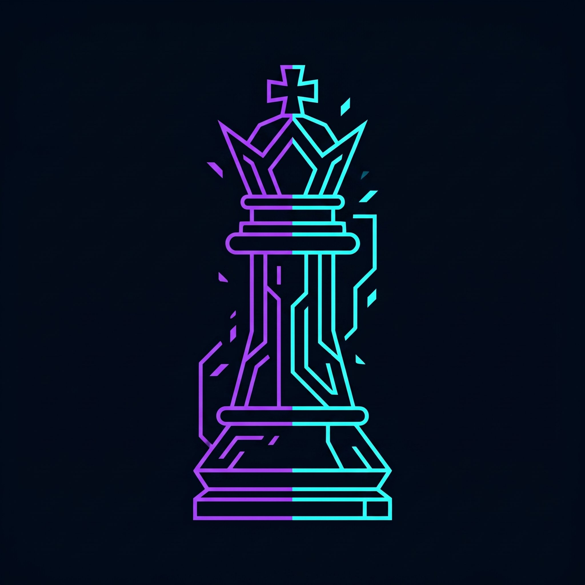
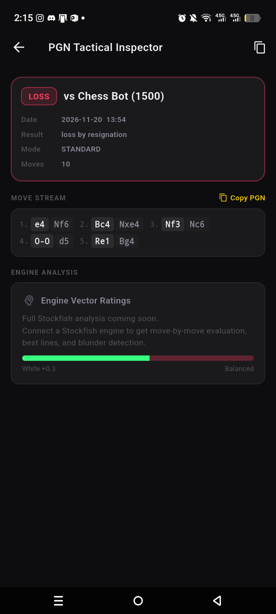
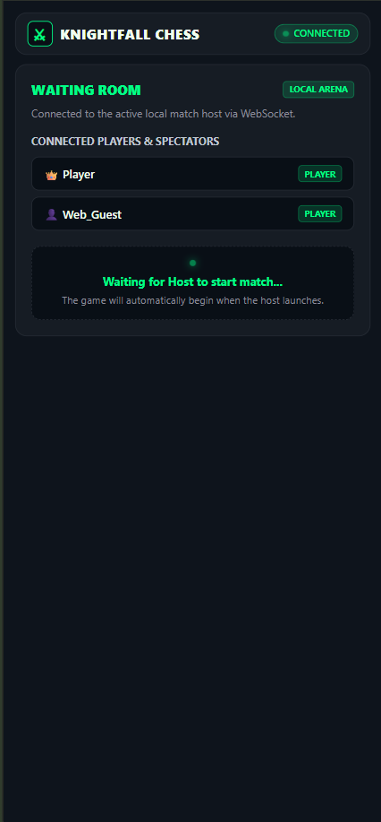

<div align="center">



# ⚔️ Knightfall Chess

**Next-Generation Zero-Internet Hotspot Chess Engine & Embedded Web Client**

[](https://flutter.dev)
[](https://dart.dev)
[](#supported-platforms)
[](#testing)
[](LICENSE)

*Play over local Wi-Fi or pure mobile hotspot with zero internet connection, zero cloud servers, and no app installation required for Player 2.*

---

</div>

## 📌 Overview

**Knightfall Chess** is a cross-platform chess application built with Flutter, designed to solve the friction of local multiplayer. Traditional mobile games require both players to download an app, create accounts, and connect to a remote cloud server. 

Knightfall Chess eliminates all of that:

1. **Embedded Native WebSocket Host:** Any Android or Windows device can host a game on its local Wi-Fi or mobile personal hotspot. The native app starts an embedded HTTP server (`0.0.0.0:8080`) that upgrades client connections to full-duplex WebSockets.
2. **Instant Browser Guest (iOS Safari / Android Chrome / PC):** The host device serves an ultra-lightweight, zero-dependency HTML5/CSS3/JavaScript chess client directly over HTTP. Player 2 simply scans the host's on-screen QR code (or opens `http://<host-ip>:8080`) on an iPhone, tablet, or laptop and jumps directly into the live match—no app store download, no cloud latency, and no mobile data required.
3. **Single-Device Pass & Play:** Seamless local pass-and-play on a single shared device with dual clock timers, turn-based orientation, draw offers, resignations, and full takeback support.
4. **Offline AI Tactical Bot:** Multi-tiered tactical bot engine with humanized non-blocking thinking delays (`800ms`–`1800ms`) and active clock countdown.

---

## 📸 Screenshots

| Lobby & Match Hub | Host QR & Connection | Active Tactical Match |
|:---:|:---:|:---:|
|  |  |  |

| Move History Navigation | Browser Web Guest | Custom Board & Piece Themes |
|:---:|:---:|:---:|
|  |  |  |

> *Tip: Place your screenshots into `docs/screenshots/` (`lobby.png`, `host_qr.png`, `match.png`, `history.png`, `web_client.png`, `themes.png`) to display them here.*

---

## ⚡ Key Features

### 🌐 Zero-Internet Hotspot Multiplayer Architecture
- **Dynamic Hotspot IPv4 Resolution:** Automatically enumerates active non-loopback network interfaces (`NetworkInterface.list()`) to bind the embedded HTTP server to the exact Wi-Fi or tethering IP.
- **Embedded Web Client:** Complete offline web client bundled into the host binary, serving board assets, SVGs, audio effects, and WebSocket synchronization scripts without any third-party CDN or external internet.
- **Cross-Platform Compatibility:** Native-to-Native (Android/Windows), Native-to-Browser (Safari on iPhone, Chrome on Android/PC), and Browser-to-Browser.

### 🎯 High-Performance Engine & Move Validation
- **Intelligent Premove Engine:** Allows players to inspect piece moves or queue a premove during the opponent's turn. Incoming moves silently recalculate legal destinations on the new board state—automatically executing if legal or silently discarding without false "Illegal move" alerts.
- **Interactive Move History Navigation:** Full interactive replay controls (`|<` First, `<` Previous, `>` Next, `>|` Live) and clickable move ticker chips. Boards lock during preview with a high-contrast "Return to Live" banner.
- **Full FIDE Compliance:** Strict pawn promotion (White on rank 8, Black on rank 1 only), en passant, kingside/queenside castling, draw by threefold repetition, 50-move rule, stalemate, and checkmate detection.

### 🤝 Synchronous Takeback & Resign Flow
- Two-way network arbitration protocol (`takeback_request`, `takeback_accept`, `takeback_decline`).
- Reverts plies and resynchronizes board positions, move history, and dual clocks across both native and web clients.

### 🔊 Dynamic Theme-Matched Audio Engine
3-tier priority audio resolution system supporting Lichess, capitalized, and custom sound formats:
1. **Piece Style Override:** Specialized audio sets (e.g., `anarcandy`).
2. **Board Theme Match:** Dynamic matching to active board textures (e.g., `wood`, `green`, `blue-marble`).
3. **Fallback Tier:** Universal standard audio suite (`default`).
- Handles `move`, `capture`, `check`, `castle`, `promote`, `premove`, `game-start`, and `game-end` events.

### 🎨 Cyber HUD & Aesthetics
- High-contrast obsidian cyber aesthetic (`#0E141C` background, `#00FF88` emerald green neon highlights).
- Pre-game entrance screens feature a subtle 30-second cross-fade background animation.
- Rich board texture selection (Wood, Marble, Metal, Canvas, Grey, Horsey, Green Plastic) and vector SVG piece sets (Alpha, Anarcandy, Caliente, California, Cardinal, Cburnett).

---

## 🏛️ Architecture & Folder Structure

```
knightfall-chess/
├── android/                   # Native Android host configuration, icons & splash
├── windows/                   # Native Windows host configuration & assets
├── assets/                    # Bundled offline assets
│   ├── backgound_app/         # Ambient lobby background cross-fade images
│   ├── board/                 # Hi-res board textures (Wood, Marble, etc.)
│   ├── logo/                  # App icon and branding (logo.jpg, logo.png)
│   ├── piece/                 # High-definition SVG chess piece sets
│   └── sound/                 # Themed audio packs (anarcandy, wood, default, etc.)
├── docs/                      # Documentation & portfolio screenshots
│   └── screenshots/
├── lib/
│   ├── core/                  # Core abstractions, providers, sound manager, models
│   │   ├── constants/         # App constants & theme palettes
│   │   ├── models/            # GameMessage, MatchRecord, Player
│   │   ├── providers/         # ThemeProvider, UserProfileProvider
│   │   ├── utils/             # SoundManager, LocalIpResolver, NetworkUtils
│   │   └── widgets/           # AnimatedBackgroundSwitcher
│   ├── engine/                # Chess rules, validation, premoves, bot AI
│   │   ├── bot_engine.dart    # Tactical bot engine with simulated human delay
│   │   ├── chess_board_state.dart # Board state management & piece selection
│   │   ├── move_validator.dart# FIDE move legality verification
│   │   └── premove_handler.dart # Premove queuing & execution logic
│   ├── features/              # Feature modules & UI screens
│   │   ├── game/              # GameScreen, BoardWidget, ClockWidget, MoveHistoryWidget
│   │   ├── history/           # Match history & PGN tactical inspector
│   │   ├── lobby/             # LobbyScreen, HostScreen, JoinScreen, QRScannerScreen
│   │   ├── modes/             # Pass & Play, King of the Hill (KOTH), Dare Mode
│   │   └── profile_themes/    # Theme customizer & player profile settings
│   ├── network/               # Networking & embedded web server layer
│   │   ├── sync_protocol.dart # Structured JSON message types & serialization
│   │   ├── tcp_server_io.dart # Embedded HttpServer + WebSocketTransformer
│   │   ├── tcp_client.dart    # WebSocketChannel client sync engine
│   │   ├── udp_discovery.dart # LAN peer auto-discovery
│   │   └── web_client_html.dart # Complete zero-dependency embedded web client
│   └── main.dart              # Application entry point & theme initialization
├── test/                      # Comprehensive test suite (43 unit & widget tests)
└── pubspec.yaml               # Package dependencies & asset declarations
```

---

## 🚀 Getting Started

### Prerequisites
- **Flutter SDK:** Version `3.3.0` or higher ([Install Guide](https://docs.flutter.dev/get-started/install))
- **Dart SDK:** Version `3.0.0` or higher
- **Android Studio / VS Code** with Flutter and Dart extensions
- *(Optional for Windows)* Visual Studio with Desktop development with C++

### 1. Clone the Repository
```bash
git clone https://github.com/koussay771/knightfall-chess.git
cd knightfall-chess
```

### 2. Install Dependencies
```bash
flutter pub get
```

### 3. Run the Test Suite
Ensure the engine, validation layer, and network synchronization pass all unit tests:
```bash
flutter test
```

### 4. Launch the App

#### Run on Android Device / Emulator:
```bash
flutter run -d android
```

#### Run on Windows Desktop:
```bash
flutter run -d windows
```

#### Build Release APK:
```bash
flutter build apk --release
```
The compiled APK will be available at: `build/app/outputs/flutter-apk/app-release.apk`.

---

## 🎮 How to Play Over Local Hotspot

```
[ Device 1: Host (Android/Windows) ]
       │
       ├─► 1. Turn on Wi-Fi Hotspot (or connect both to same Wi-Fi)
       ├─► 2. Open Knightfall Chess -> Tap "HOST MATCH"
       │      • Displays dynamic IP & QR Code
       │
       ▼
[ Device 2: Guest (iPhone, Android, PC) ]
       │
       ├─► 3. Connect to Host's Hotspot / Wi-Fi
       ├─► 4. Open Camera and scan the QR Code
       │      (Or open browser and go to http://<host-ip>:8080)
       ▼
[ Instant Multiplayer Chess Begins! ]
```

---

## 🧪 Testing & Code Quality

Knightfall Chess maintains strict code quality and test coverage across the chess engine, WebSocket protocol, and board state management:

```bash
# Verify static analysis (0 warnings / 0 errors)
flutter analyze --no-fatal-infos

# Run full test suite
flutter test
```

All 43 unit and widget tests verify:
- Move legality, promotion, castling, and en passant
- Dual clock synchronization and timeout enforcement
- WebSocket message serialization and protocol handshakes
- Takeback request, accept, and decline arbitration flows
- Premove validation and silent recovery on opponent moves
- Bot engine decision trees and thinking delays

---

## 🛠️ Built With

- [Flutter](https://flutter.dev) - Cross-platform UI framework
- [chess](https://pub.dev/packages/chess) - Chess rules and move generation engine
- [web_socket_channel](https://pub.dev/packages/web_socket_channel) - Cross-platform WebSocket communication
- [audioplayers](https://pub.dev/packages/audioplayers) - Low-latency audio playback
- [qr_flutter](https://pub.dev/packages/qr_flutter) - High-resolution dynamic QR code rendering
- [mobile_scanner](https://pub.dev/packages/mobile_scanner) - Native camera QR code scanner
- [flutter_svg](https://pub.dev/packages/flutter_svg) - High-performance SVG piece rendering
- [sqflite](https://pub.dev/packages/sqflite) - Local match history database

---

## 📄 License

This project is licensed under the MIT License - see the [LICENSE](LICENSE) file for details.

---

<div align="center">
Crafted with ⚔️ by <b>Knightfall Chess Team</b>
</div>
